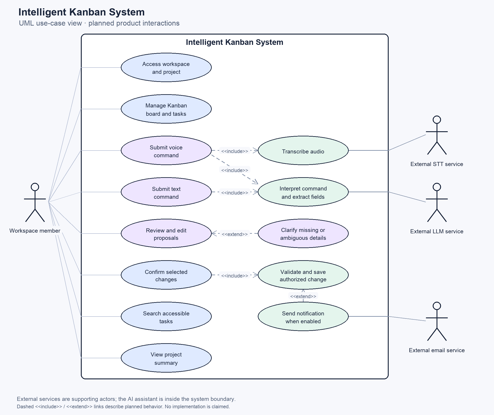

# FE-05: Use Case Overview

Status: Draft for team review; UML diagram prepared for pre-defense.

This diagram describes planned user interactions. It does not represent completed implementation.

## Actors

- **Workspace member:** an authenticated employee, project manager, teacher, or student. Available actions depend on workspace and project permissions.
- **External speech-to-text (STT) service:** supports audio transcription outside the application boundary.
- **External language-model (LLM) service:** supports interpretation and field extraction outside the application boundary.
- **External email service:** supports planned notifications when they are enabled. Notifications are later-scope work.

The AI assistant and its review and confirmation logic are inside the system boundary. The external services are supporting actors, not users of the product.

## System boundary and use cases

The [PNG diagram](use-case-diagram.png) is generated from the editable [Python source](render_use_case.py). It shows planned interactions, not completed implementation. Solid lines associate actors with use cases; dashed UML dependencies describe required or conditional behavior:

| Relationship | Meaning |
| --- | --- |
| Submit voice command `<<include>>` Transcribe audio and Interpret command | Audio must be transcribed and interpreted before proposals can be shown. |
| Submit text command `<<include>>` Interpret command | Text enters the same interpretation flow after transcription is skipped. |
| Confirm selected changes `<<include>>` Validate and save authorized change | Confirmation always reaches backend validation before any data change. |
| Clarify missing or ambiguous details `<<extend>>` Review and edit proposals | Clarification appears only when the proposal is incomplete or ambiguous. |
| Send notification `<<extend>>` Validate and save authorized change | Notification is conditional and belongs to later product scope. |

The diagram groups manual board operations into one use case. The AI action table below gives the eight action-level details; the first MVP plans CreateTask only.

## AI action coverage

| AI action | User goal | Expected result |
|---|---|---|
| CreateTask | Create one or several tasks from a command | Editable task proposals |
| UpdateTask | Change an existing task's title or description | Preview of the proposed changes |
| ChangeStatus | Move a task to another board column | Preview of the status change |
| AssignUser | Assign or reassign a task | Preview of the selected workspace member |
| ChangeDeadline | Set or change a deadline | Preview of the interpreted date |
| ChangePriority | Set or change a priority | Preview of the new priority |
| SearchTasks | Find tasks matching a request | Matching tasks visible to the user |
| ProjectSummary | Understand project progress | Summary based on accessible project data |

## Interaction rules

- Voice input is transcribed before command interpretation.
- Users can inspect and correct the transcription.
- One command can propose several tasks or changes.
- Proposed changes remain unapplied until confirmed.
- Users can edit proposals, deselect actions, or cancel.
- Clarification is requested when a task or assignee cannot be identified reliably.
- An assignee can remain Unassigned when assignment is optional.
- Permissions and task data are validated before applying changes.
- Search and summary requests do not change board data.
- The AI assistant is part of the system, not a separate human actor.

## Related documents

- [Product requirements](../product-requirements.md)
- [User flows](../user-flows.md)
- [Interactive prototype](../../prototype/index.html)
