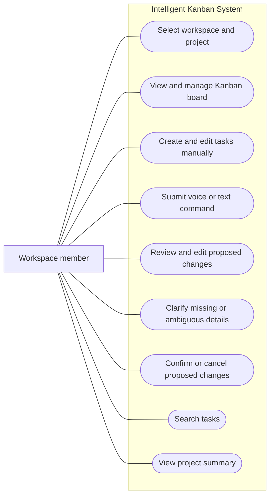

# FE-05: Use Case Overview

Status: Draft for team review.

This diagram describes planned user interactions. It does not represent completed implementation.

## Actor

An authenticated workspace member, such as an employee, project manager, teacher, or student. Available actions depend on workspace and project permissions.

## System boundary and use cases

This is a use-case overview expressed with Mermaid. Connections show user interactions, not processing order.

## AI action coverage

| AI action | User goal | Expected result |
|---|---|---|
| CreateTask | Create one or several tasks from a command | Editable task proposals |
| UpdateTask | Change an existing task's title or description | Preview of the proposed changes |
| ChangeStatus | Move a task to another board column | Preview of the status change |
| AssignUser | Assign or reassign a task | Preview of the selected workspace member |
| ChangeDeadline | Set or change a deadline | Preview of the interpreted date |
| ChangePriority | Set or change a priority | Preview of the new priority |
| SearchTasks | Find tasks matching a request | Matching tasks visible to the user |
| ProjectSummary | Understand project progress | Summary based on accessible project data |

## Interaction rules

- Voice input is transcribed before command interpretation.
- Users can inspect and correct the transcription.
- One command can propose several tasks or changes.
- Proposed changes remain unapplied until confirmed.
- Users can edit proposals, deselect actions, or cancel.
- Clarification is requested when a task or assignee cannot be identified reliably.
- An assignee can remain Unassigned when assignment is optional.
- Permissions and task data are validated before applying changes.
- Search and summary requests do not change board data.
- The AI assistant is part of the system, not a separate human actor.

## Related documents

- [Product requirements](../product-requirements.md)
- [User flows](../user-flows.md)
- [Interactive prototype](../../prototype/index.html)
